# 팰월드 모작: 팰(몬스터) 전투 AI

  <a href="https://youtu.be/1EZR6WACutA">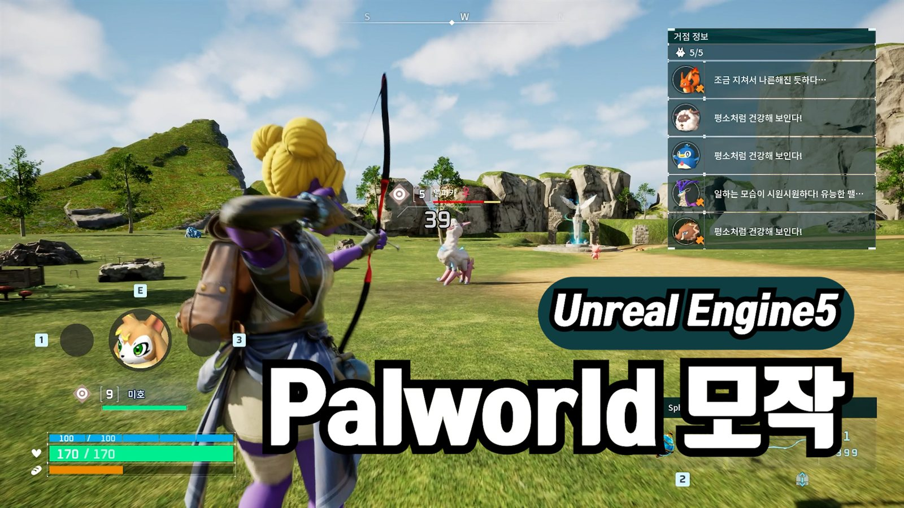</a>
    
  👇 <b>유튜브 영상 바로가기</b>
   
  <a href="https://youtu.be/1EZR6WACutA">https://youtu.be/1EZR6WACutA</a>

  

## 📌 프로젝트 개요
- **Unreal Engine 5.8을 사용한 “팰월드” 모작 (멀티플레이)**
- **GAS, StateTree, AI Perception 기반으로 팰 22종의 AI, 전투, 포획, 탑승 구현**
- **팰 22종이 하나의 C++ 클래스를 공유하고, 종별 차이는 데이터 에셋으로 관리**
- **개발 기간 : 2026. 00. 00 ~ 2026. 00. 00**

  

## 👥 팀원 소개

|  |  |  |  |
| :---: | :---: | :---: | :---: |
| 김정훈 | 박지호 | 탁예지 | 정승현 |
| 빌딩시스템, 크래프팅 | 플레이어 | Pal(몬스터)AI | 아이템, 인벤토리 |
|  |  |  |  |

  

## 💻 개발 환경

| IDE | Language | OS | Engine | Communication |
| :---: | :---: | :---: | :---: | :---: |
|  |   |  |  |    |

  

## 🛠️ 주요 구현 내용 (탁예지)

> 담당: 팰(몬스터) 전투/AI. 팰의 데이터, AI, 스킬, 포획, 탑승 설계 및 구현

### ① 팰 AI 전투 루프 (AI 컨트롤러 + StateTree)

  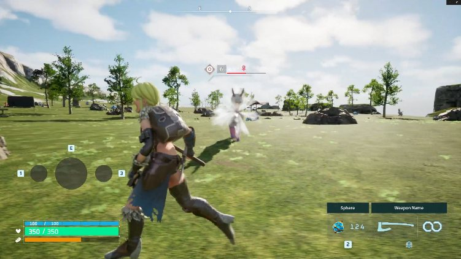
  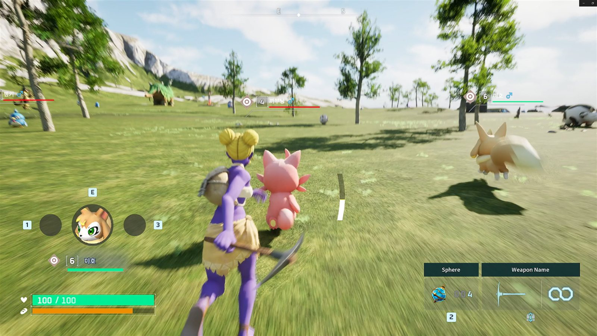

 

~~~cpp
// ADC1PalAIController::UpdateSelectedSkill (발췌)
if (true == SelectedSkillTag.IsValid()) { return; }   // 이미 선택했으면 유지 (접근 중 재선택 방지)
for (const FGameplayTag& SkillTag : PalData->SkillTags)
{
    const FDC1PalSkillDef* Def = Registry->FindSkillDef(SkillTag);
    if (CooldownTag.IsValid() && ASC->HasMatchingGameplayTag(CooldownTag)) { continue; }  // 쿨타임 중인 스킬 제외
    Candidates.Add({ SkillTag, Def->MaxRange, Def->ApproachRange, Def->MinRange });
}
if (0 == Candidates.Num()) { return; }   // 모두 쿨타임이면 CombatIdle에서 대기

// 거리와 무관하게 먼저 선택하고, 사거리 3종은 평가자를 통해 전이 조건에 전달
const FSkillCandidate& Picked = Candidates[FMath::RandRange(0, Candidates.Num() - 1)];
SelectedSkillTag = Picked.SkillTag;
SelectedMaxRange = Picked.MaxRange;
~~~

| 핵심 기술 | 구현 내용 및 설명 |
| :--- | :--- |
| **판단과 행동의 분리** | StateTree 태스크의 인스턴스 데이터는 상태를 벗어나면 초기화되므로, 여러 상태에서 유지해야 하는 표적, 반격 대상, 선택 스킬은 AI 컨트롤러에 저장. StateTree는 평가자(`FDC1PalTargetEvaluator`) 출력으로 전이 조건만 판단 |
| **StateTree 4개** | 야생(`ST_PalWild`), 파트너(`ST_PalPartner`), 거점(`ST_PalBase`), 전투 공용(`ST_PalCombat`, 링크드 에셋)으로 구성. 전투 트리를 공유해 야생 팰과 파트너 팰이 같은 전투 로직 사용 |
| **표적 선택 순서** | 스킬 사용 중 유지 → 반격(`ProvokedTarget`, 놓치면 `Aggressors` 중 최근접) → 주인 지원 → 기존 표적 유지 → 최근접 대상 순으로 선택. 기존 표적이 보이는 동안은 최근접 대상보다 우선 |
| **스킬 우선 선택** | 스킬을 먼저 확정한 뒤 해당 스킬의 사거리 3종(최대, 접근, 최소)으로 Chase, Backoff, Attack 상태를 결정해 사거리 경계에서도 행동이 일정하게 유지 |
| **AI Perception** | 종 데이터로 시야 반경, 시야각, 기억 시간을 설정하고 적 진영만 감지. 거리는 캡슐 표면 사이 거리로 계산해 몸 크기가 다른 팰끼리도 사거리 일치 |

### ② 데이터 기반 스킬 시스템

  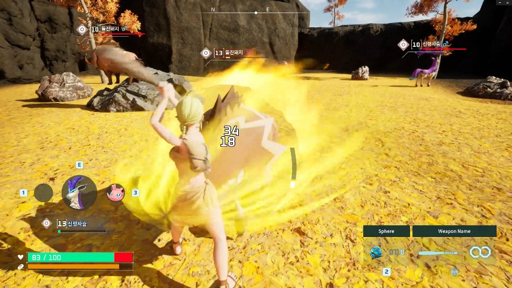
  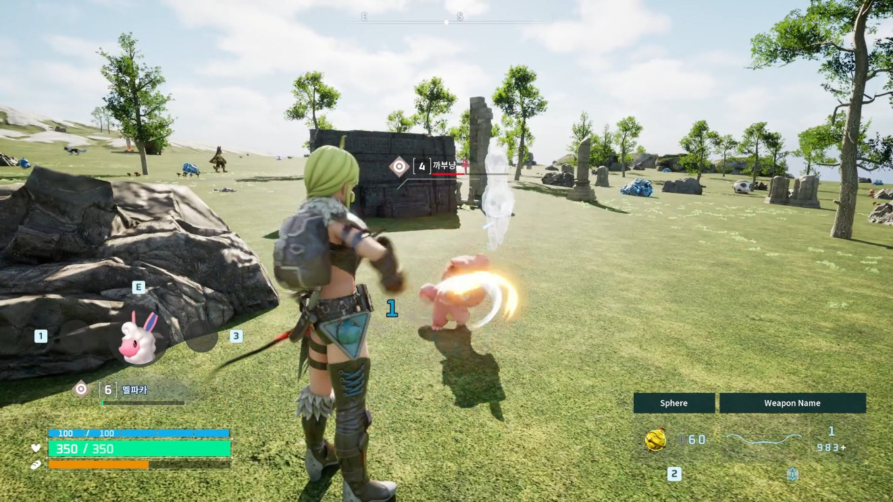
  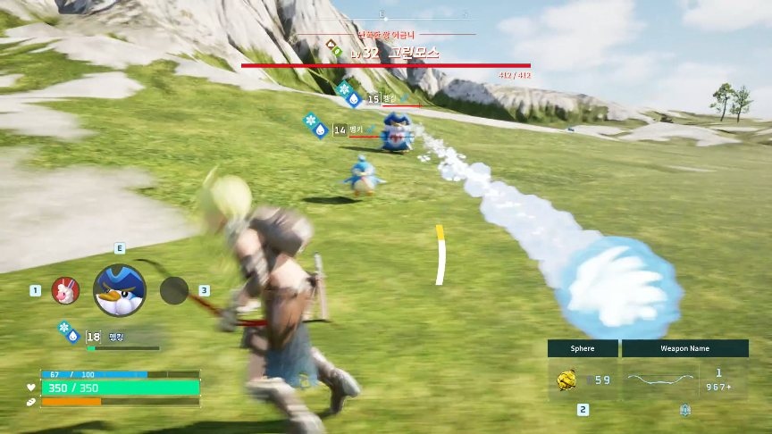

 

> 원작의 스킬은 300개가 넘지만 동작 유형은 몇 가지로 나뉨. 동작은 C++ 어빌리티 3개(돌진, 근접, 원거리)로, 개별 스킬은 스킬표의 한 줄로 분리해 새 스킬을 스킬표 한 줄과 태그 2개로 추가할 수 있도록 구성.

~~~cpp
// ADC1PalCharacter::GrantSkillAbilities: 보유 스킬마다 Spec을 따로 부여
for (const FGameplayTag& SkillTag : PalData->SkillTags)
{
    if (const FDC1PalSkillDef* Def = Registry->FindSkillDef(SkillTag))
    {
        // 동작 어빌리티(Def->ActivationTag)는 같아도 Spec에 스킬 태그를 기록해 구분
        AbilityData->GiveVariant(AbilitySystemComponent, Def->ActivationTag, SkillTag, this);
    }
}

// UDC1GameplayAbility_PalSkill::FindSkillTag: Spec의 DynamicSpecSourceTags 중 Pal.Skill 하위 태그가 스킬 태그
const FGameplayAbilitySpec* Spec = (nullptr != ASC) ? ASC->FindAbilitySpecFromHandle(Handle) : nullptr;
for (const FGameplayTag& Tag : Spec->GetDynamicSpecSourceTags())
    if (true == Tag.MatchesTag(SkillRoot)) { return Tag; }
~~~

| 핵심 기술 | 구현 내용 및 설명 |
| :--- | :--- |
| **동작과 수치의 분리** | 어빌리티 클래스 3개(`Tossin`, `NearSkill`, `FarSkill`, 공통 부모 `UDC1GameplayAbility_PalSkill`)와 스킬표 33줄(속성, 위력, 쿨타임, 사거리, 탄, 발 수 등)로 구성. 대지 강타는 별도 클래스 없이 근접 스킬 한 줄(판정 반지름 400)로 구현 |
| **Spec 태그로 스킬 식별** | 스킬 정보를 호출하는 쪽(AI, 탑승 입력)이 아닌 Spec에서 조회하므로, 누가 발동하든 같은 경로와 같은 스킬표 값을 사용 |
| **노티파이 기반 타격 판정** | 타격 시점은 애니메이션 노티파이가 Gameplay Event로 전달하고, 판정은 서버에서만 수행. 노티파이 하나당 판정 1회 |
| **3층 데이터 구조** | 전 종 공용 `DA_PalRegistry`(스킬표, 상성, 성장), 종별 `DA_Pal_<종>` 22개(보유 스킬, 몽타주, 스탯 계수), 개체별 `FDC1PalInstance`(종 태그, 레벨, 현재 체력)로 분리. 모든 조회는 종 태그에서 시작 |

### ③ 스킬 단위 쿨타임

  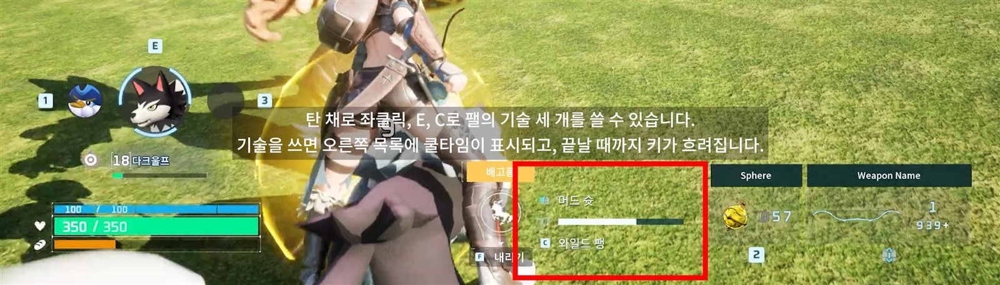

 

> GAS 기본 쿨타임은 어빌리티 클래스 단위로 동작하고, `GetCooldownTags()`는 Spec 핸들을 받지 않아 클래스를 공유하는 스킬을 구분할 수 없음. Spec 핸들을 받는 `CheckCooldown` / `ApplyCooldown`을 오버라이드하고, 쿨타임 GE 클래스 하나에 지속 시간과 태그를 발동 시점에 지정하는 방식으로 구현.

~~~cpp
// UDC1GameplayAbility_PalSkill::ApplyCooldown (발췌)
const FGameplayTag SkillTag    = FindSkillTag(Handle, ActorInfo);
const FGameplayTag CooldownTag = DC1PalTags::FindSkillCooldownTag(SkillTag);   // "Cooldown." + 스킬 태그
const FDC1PalSkillDef* Def = Registry->FindSkillDef(SkillTag);                   // 스킬표 항목

FGameplayEffectSpecHandle SpecHandle = MakeOutgoingGameplayEffectSpec(Handle, ActorInfo, ActivationInfo,
    UDC1GameplayEffect_PalSkillCooldown::StaticClass(), GetAbilityLevel(Handle, ActorInfo));
SpecHandle.Data->SetDuration(Def->Cooldown, true);           // 지속 시간: 스킬표의 쿨타임
SpecHandle.Data->DynamicGrantedTags.AddTag(CooldownTag);     // 부여 태그: 해당 스킬의 쿨타임 태그
ApplyGameplayEffectSpecToOwner(Handle, ActorInfo, ActivationInfo, SpecHandle);
~~~

| 핵심 기술 | 구현 내용 및 설명 |
| :--- | :--- |
| **핸들 → Spec → 스킬 태그** | 핸들로 Spec을 찾고, `DynamicSpecSourceTags`에서 스킬 태그를 조회해 같은 어빌리티 클래스를 쓰는 스킬마다 쿨타임을 따로 적용 |
| **쿨타임 GE 1개** | 하나의 쿨타임 GE 클래스에 지속 시간(스킬표의 쿨타임)과 태그를 발동 시점에 지정. 새 스킬의 쿨타임은 스킬표 값으로 적용 |
| **태그 규칙** | 쿨타임 태그는 `"Cooldown." + 스킬 태그` 규칙으로 조회 |
| **쿨타임 공유** | 쿨타임 태그가 팰 ASC에 부여되어 복제되므로 AI 스킬 선택, 탑승 입력, HUD가 같은 태그를 참조. 탑승 중 사용한 스킬의 쿨타임은 하차 후 AI에게도 그대로 유지 |

### ④ 데미지 계산 (Execution)
> 데미지 = 위력(스킬표) × (공격 ÷ 방어) × 속성 상성 × 속성 일치 보너스. 팰 전용 Execution 하나에서 계산하고, 플레이어 공격처럼 공격력이 이미 반영된 데미지는 그대로 통과시켜 공식이 한 번만 적용되도록 구성.

~~~cpp
// UDC1PalDamageExecution (발췌)
// 공격력은 가해자에게서 발사 시점에 스냅샷, 방어력은 대상에게서 적용되는 순간에 읽음
AttackPowerDef  = FGameplayEffectAttributeCaptureDefinition(
    UDC1CharacterAttributeSet::GetAttackPowerAttribute(), EGameplayEffectAttributeCaptureSource::Source, true);
DefensePowerDef = FGameplayEffectAttributeCaptureDefinition(
    UDC1AttributeSet::GetDefensePowerAttribute(), EGameplayEffectAttributeCaptureSource::Target, false);

// 데미지 = 위력 × (공격력 ÷ 대상 방어력)
float Damage = BasePower * (AttackPower / EffectiveDefense);

// 상성: 대상이 팰일 때만, 이중 속성은 각각 적용
Damage *= Registry->GetElementMultiplier(SkillElement, TargetPal->GetElement(), TargetPal->GetElement2());

// 일치 보너스: 스킬 속성이 시전한 팰의 속성과 같으면 ×1.2
if (SkillElement == SourcePal->GetElement() || SkillElement == SourcePal->GetElement2())
{
    Damage *= Registry->ElementMatchBonus;
}
~~~

| 핵심 기술 | 구현 내용 및 설명 |
| :--- | :--- |
| **Attribute Capture** | 공격력은 Source 스냅샷(발사 시점 값), 방어력은 Target 비스냅샷(피격 시점 값)으로 캡처 |
| **속성 상성** | 공용 데이터의 상성표로 약점 ×2, 이중 속성은 각각 곱해 적용 |
| **팰 전용 데미지 GE** | 팰 스킬이 아닌 공격은 SetByCaller로 받은 완성된 데미지를 그대로 Damage 메타 어트리뷰트에 전달 |
| **아군 피해 차단** | 팰 AttributeSet의 `PreGameplayEffectExecute`에서 적이 아닌 가해자의 피해를 출처와 무관하게 차단 |

### ⑤ 탑승 (Possess + CMC 이동 예측)

  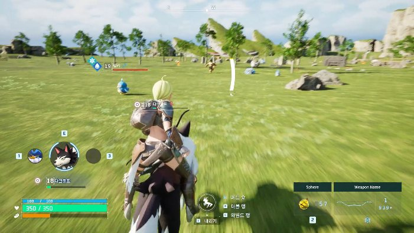
  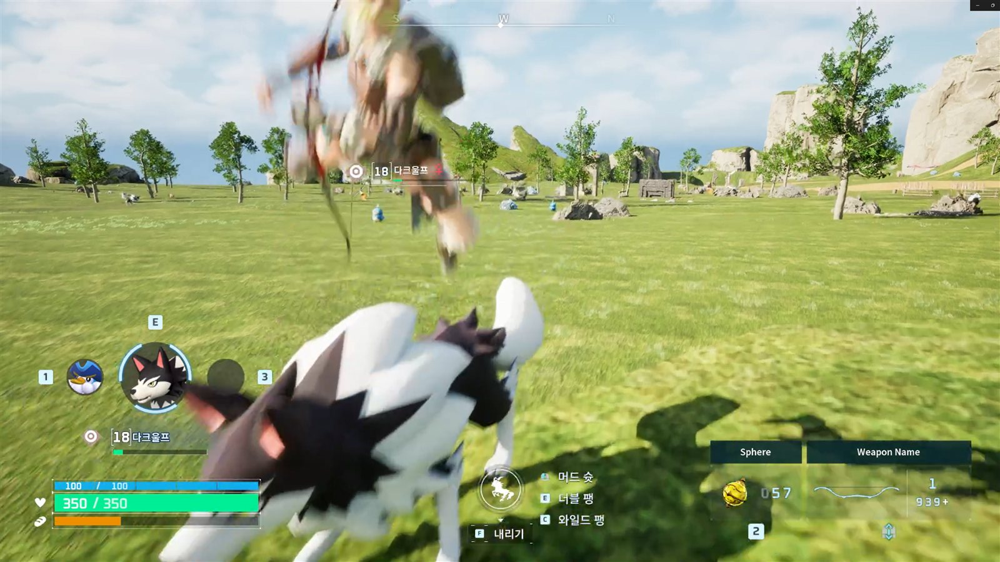

 

> 플레이어 컨트롤러가 팰을 Possess하도록 해 CharacterMovementComponent의 클라이언트 예측을 그대로 사용. 질주 여부는 커스텀 `FSavedMove`의 압축 플래그에 담아 서버와 클라이언트가 같은 속도로 계산.

~~~cpp
// FSavedMove_DC1Pal: 질주 여부를 이동 기록에 저장하고 압축 플래그로 서버에 전송
uint8 FSavedMove_DC1Pal::GetCompressedFlags() const
{
    uint8 Result = Super::GetCompressedFlags();
    if (Saved_bWantsToRideSprint) { Result |= RIDE_SPRINT; }
    return Result;
}

// 서버 보정 후 리플레이할 때 저장된 값으로 복원
void FSavedMove_DC1Pal::PrepMoveFor(ACharacter* C)
{
    Super::PrepMoveFor(C);
    if (UDC1PalMovementComponent* CMC = Cast<UDC1PalMovementComponent>(C->GetCharacterMovement()))
    {
        CMC->Safe_bWantsToRideSprint = Saved_bWantsToRideSprint;
    }
}

// 서버: 받은 플래그로 질주 여부 갱신
void UDC1PalMovementComponent::UpdateFromCompressedFlags(uint8 Flags)
{
    Super::UpdateFromCompressedFlags(Flags);
    Safe_bWantsToRideSprint = (0 != (Flags & FSavedMove_DC1Pal::EMoveFlag::RIDE_SPRINT));
}
~~~

  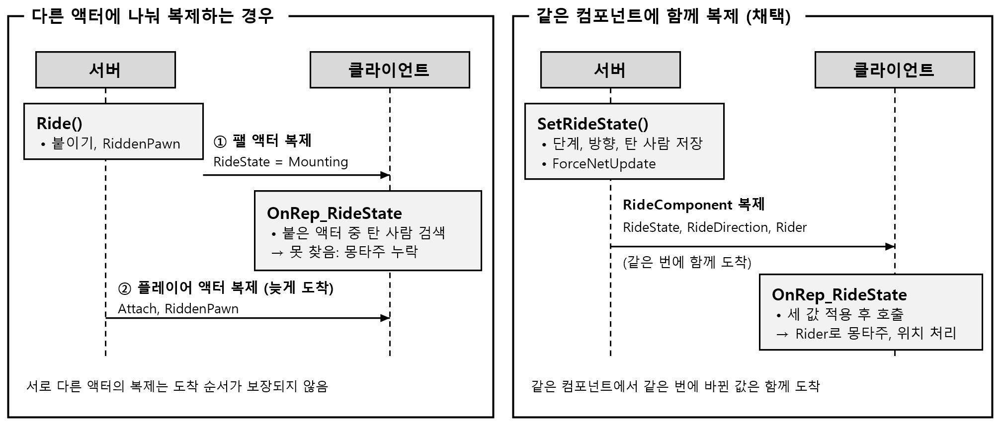

 

| 핵심 기술 | 구현 내용 및 설명 |
| :--- | :--- |
| **탑승 흐름** | F 1초 홀드(Enhanced Input Hold 트리거) → 팰 접근 → 등 소켓에 부착 → 플레이어 컨트롤러가 팰을 Possess하고 탑승용 IMC로 입력 교체 |
| **탑승 상태 복제** | 서로 다른 액터의 복제는 도착 순서가 보장되지 않으므로, 탑승자를 단계, 방향과 같은 `PalRideComponent`에 두어 한 번에 복제. 단계 값의 복제를 몽타주 재생 신호로 사용 |
| **위치 보간** | 원본 애니메이션에 루트 모션이 없어 위치는 코드로, 이동 시점은 몽타주 노티파이 구간으로 결정. 최종 위치는 서버에서 직접 보정 |
| **탑승 스킬, HUD** | 좌클릭, E, C에 해당 종의 스킬 1~3을 할당. 쿨타임 태그로 입력을 제한하고 같은 태그로 HUD 쿨타임을 표시해 화면 표시와 실제 쿨타임 일치 |
| **탑승 질주** | 질주 어빌리티(LocalPredicted)가 팰의 스태미나를 소모하고, 종별 원작 질주 속도와 스태미나 적용 |

### ⑥ 포획 판정

  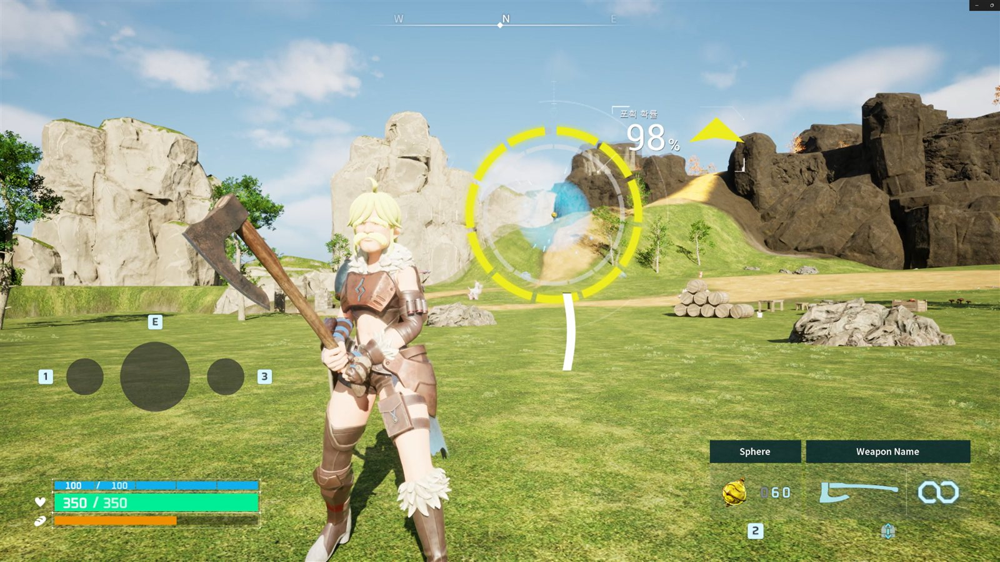
  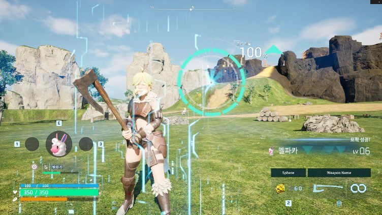

 

> 스피어 등급 → 체력 보정 → S자 곡선 → 종별 포획률 순으로 포획 확률을 계산. 확률 계산은 스피어가 담당해 스피어 종류가 늘어나도 팰 코드는 그대로 유지.

~~~cpp
// ADC1PalSphere::ComputeCaptureChance (발췌)
// ① 레벨 차: 스피어 등급과 팰 레벨을 비교해 0~1로 정규화
const float LevelGap = SphereLevel + (CapturePower * 0.5f) - InPalLevel;
const float NormalizedLevel = FMath::Clamp((LevelGap + 50.f) / 99.f, 0.f, 1.f);

// ② 체력 보정: 최대 체력 0.769 ~ 빈사 1.0
const float Combined = FMath::Pow(1.3f, -InHealthRatio) * NormalizedLevel;

// ③ 9제곱 S자 곡선: 0.35~0.55 구간에서 기울기가 급해 체력을 깎을수록 확률이 크게 상승
const float BaseChance = (Combined >= 0.5f)
    ? (1.f - (FMath::Pow(2.f - (2.f * Combined), 9.f) / 2.f))
    : (256.f * FMath::Pow(Combined, 9.f));

// ④ 종별 포획률 보정
return FMath::Clamp(BaseChance * InCaptureRate, 0.f, 1.f);
~~~

| 핵심 기술 | 구현 내용 및 설명 |
| :--- | :--- |
| **3단계 판정** | 단계별 유지 확률을 `전체 확률^(가중치/합)`으로 두어 세 단계를 곱하면 전체 확률이 되도록 구성. 앞 단계일수록 유지 확률이 낮음 |
| **서버 판정, 클라이언트 연출** | 판정은 서버에서 수행하고, 클라이언트는 복제된 상태와 게이지 값으로 반구 열림과 게이지 연출만 처리 |
| **포획 성공 알림** | 별도 RPC 없이 기존에 복제되던 게이지 값에 포획한 팰 데이터를 포함해, 던진 플레이어 화면에만 대기열 방식으로 표시 |
| **스피어 6등급 [협업]** | 원작 포획력 기준 6등급. 팀원이 만든 던지기 어빌리티(`GA_Player_PalSphere`)에 스피어 스폰, 결과 연결, 파티 만원 검사, 인벤토리 소모를 추가 |

### ⑦ 액터 ↔ 데이터 변환 (파티, 상자, 성장)
> 팰은 월드의 액터 또는 데이터 한 줄(`FDC1PalInstance`), 두 형태 중 하나로 존재. 포획과 회수 시에는 액터를 데이터로 변환(`Fold`)하고, 소환 시에는 데이터로 액터를 다시 스폰(`SpawnFromInstanceData`).

~~~cpp
// Fold: 액터 → 데이터
FDC1PalInstance ADC1PalCharacter::Fold()
{
    FDC1PalInstance Instance = PalInstance;
    Instance.SpeciesTag = SpeciesTag;
    Instance.PalID = InstanceID.IsValid() ? InstanceID : FGuid::NewGuid();   // GUID로 개체 식별
    Instance.CurrentHealth = PalAttributeSet->GetHealth();
    Instance.CurrentSanity = PalAttributeSet->GetSanity();
    Instance.Level = GetLevel();

    StopAndUnregister();
    Destroy();
    return Instance;
}

// SpawnFromInstanceData: 데이터 → 액터 (발췌)
ADC1PalCharacter* Pal = InWorld->SpawnActorDeferred<ADC1PalCharacter>(PalClass, InTransform, nullptr, nullptr,
    ESpawnActorCollisionHandlingMethod::AdjustIfPossibleButAlwaysSpawn);
Pal->SpeciesTag = InInstance.SpeciesTag;
Pal->OwnerPlayerState = InOwner;
Pal->BasePalBox = InBasePalBox;      // OnPossess가 이 값으로 StateTree를 고르므로 FinishSpawning 전에 설정
Pal->PalInstance = InInstance;
Pal->FinishSpawning(InTransform);

Pal->PalAttributeSet->SetHealth(InInstance.CurrentHealth);   // 저장된 현재 체력은 스폰 후 적용
~~~

| 핵심 기술 | 구현 내용 및 설명 |
| :--- | :--- |
| **파티 5, 상자 30** | PlayerState 컴포넌트에서 슬롯 배열을 복제하고 OnRep으로 갱신. 같은 종의 서로 다른 개체를 구분하기 위해 아이템 인벤토리와 별도로 설계 |
| **소환 요청** | 소환 요청에 선택한 슬롯 번호를 함께 전달해 화면의 슬롯과 소환되는 팰이 일치 |
| **저장하지 않는 값** | 최대 체력, 속도, 스킬은 종 데이터와 스킬표에서 매번 다시 계산해, 데이터를 수정하면 이미 포획한 팰에도 반영. 주인 정보는 Pawn이 아닌 PlayerState로 보관해 리스폰이나 탑승 후에도 유지 |
| **경험치, 레벨업** | 처치와 포획 시 파티 전원에게 경험치를 지급하고, 액터가 없는 슬롯의 팰을 위해 경험치는 데이터에만 기록. 레벨업은 BaseValue만 변경해 패시브 배율 유지 |

### ⑧ UI, 거점, 이펙트

  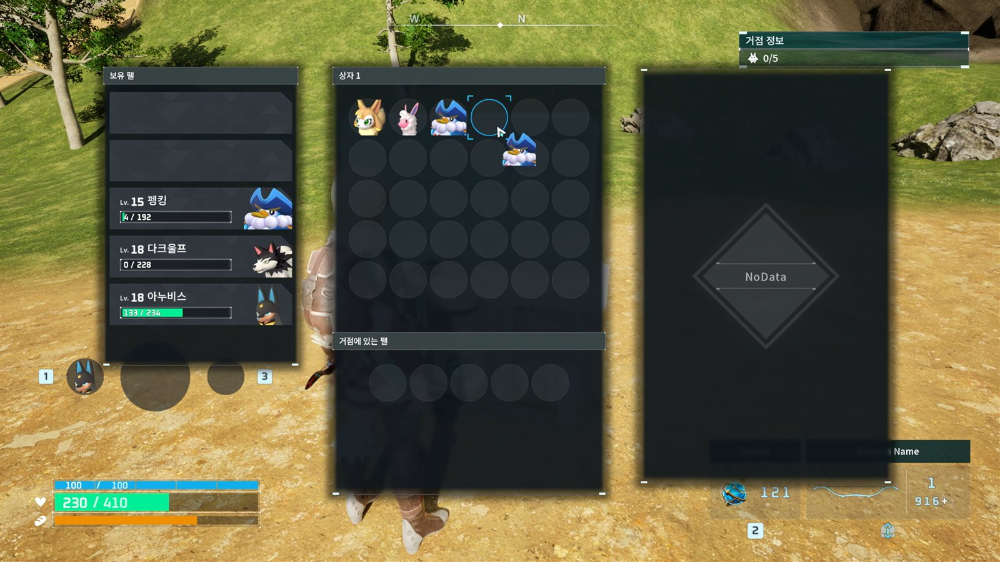
  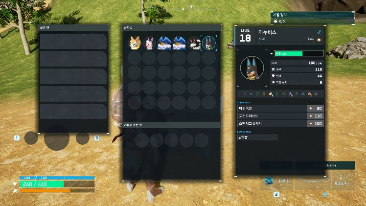

 

| 영역 | 구현 내용 및 설명 |
| :--- | :--- |
| **팰박스 화면 (MVVM)** | 위젯 9개와 전용 ViewModel로 파티, 상자, 거점, 상세 정보 화면 구성. 드래그 중에는 화면 위젯이 Preview 이벤트로 입력을 먼저 처리하고, 드롭 슬롯은 좌표로 판별 |
| **HUD, 알림 (UMG, RPC)** | 머리 위 HP바, 알파(필드 보스) HP바, 거점 정보 HUD, 획득 및 처치 알림(Client RPC) |
| **거점 [협업]** | 팀원이 만든 거점 구조 위에 팰박스 건물, 거점 팰의 작업 대상 선택, 이동, SAN 증감, 수면 구현 |
| **이펙트 (Niagara)** | 원거리 탄 15개, 돌진 및 근접 이펙트 10종. 원작 NS, MI 데이터를 분석해 공용 부모 머티리얼 18개 구성 |
